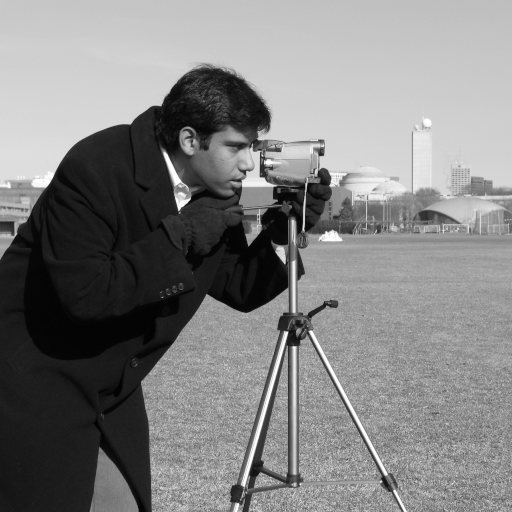
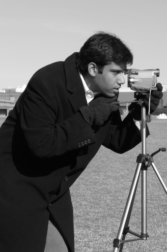
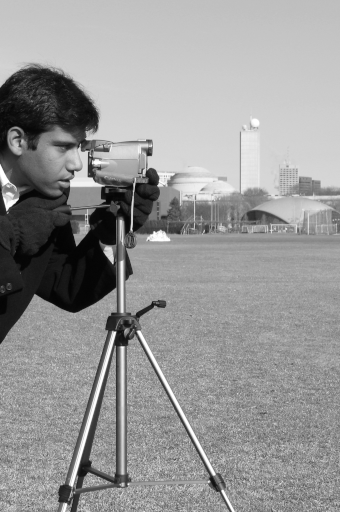
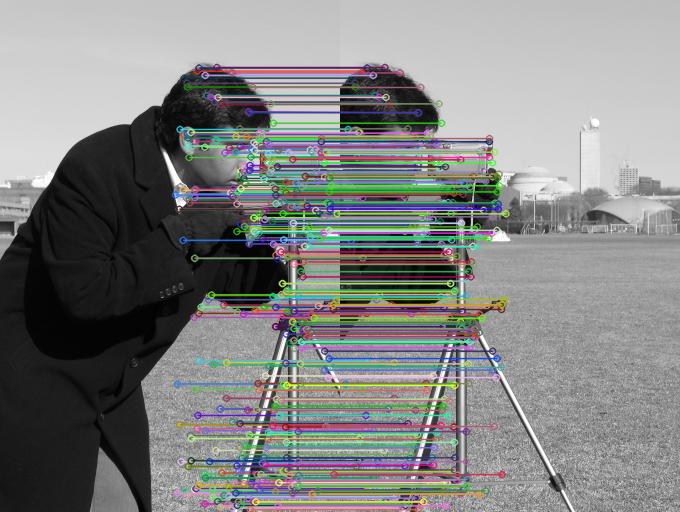

# 实验三：基于 SIFT 特征匹配的图像拼接实验报告

## 一、实验目的

1. 理解 SIFT 特征点检测与特征描述符的基本思想。
2. 掌握 FLANN 特征匹配及 Lowe 比率测试筛选方法。
3. 学习使用 RANSAC 估计单应矩阵并去除错误匹配。
4. 掌握利用透视变换和画布平移实现两张重叠图片的拼接。
5. 通过实际结果观察图像匹配效果，分析拼接时可能出现的边界与重叠问题。

## 二、实验原理

本实验采用“**图像分割 → 特征提取 → 特征匹配 → 估计单应矩阵 → 透视变换 → 图像融合/覆盖**”的处理流程。

### 2.1 SIFT 特征提取

SIFT（尺度不变特征变换）可以定位局部关键点，并计算其特征描述符。通过 `cv2.SIFT_create()` 创建检测器，对分割后的两幅图像分别执行 `detectAndCompute()`，得到关键点 `kp_a`、`kp_b` 和描述符 `des_a`、`des_b`。

### 2.2 FLANN 匹配与 Lowe 比率测试

使用 FLANN 的 KD-tree 索引加速浮点型 SIFT 描述符的近邻搜索。针对每个描述符寻找两个最近邻，保留满足以下条件的匹配：

$$d_1 < 0.7d_2$$

其中 $d_1$ 和 $d_2$ 分别为第一、第二近邻的描述符距离。该筛选可减少模糊匹配。

### 2.3 RANSAC 和单应矩阵

利用对应点估计 3×3 单应矩阵 $H$，其几何关系为：

$$\mathbf{p}\prime \sim H\mathbf{p}$$

调用 `cv2.findHomography(src_pts, dst_pts, cv2.RANSAC, 5.0)`，通过反复采样与内点判别，降低错误对应点对估计的影响。本实验是从同一幅原图直接裁切得到两张图片，因此理论上的主要变换为水平平移。

### 2.4 透视变换与拼接

将右侧图片依据 $H$ 投影到左侧图片的坐标系，计算变换后图像角点与左图角点的联合包围框，再构建平移矩阵 $T$，使输出像素均在画布内：

$$I_{out} = \operatorname{warpPerspective}(I_b, T H)$$

最后把左侧图片覆盖在画布的对应位置。该覆盖式融合与参考代码一致；相比多频段融合，它实现简单，但在曝光或视角差异较大时可能产生接缝。

## 三、实验环境和数据

| 项目 | 内容 |
|---|---|
| 编程语言 | Python 3 |
| 图像处理库 | OpenCV (`cv2`)、NumPy、scikit-image |
| 输入图像 | `skimage.data.camera()`，真实摄影灰度测试图 |
| 原图尺寸 | 512 × 512 像素 |
| 左图裁切范围 | 列 `[0:340]`，尺寸 340 × 512 |
| 右图裁切范围 | 列 `[172:512]`，尺寸 340 × 512 |
| 两图重叠区域 | 168 像素，约占单张子图宽度 49.4% |
| 匹配条件 | Lowe 比率阈值 0.7 |
| RANSAC 阈值 | 5.0 像素 |

> 图像来源说明：测试原图为 scikit-image 提供的 `camera` 示例照片。此处不是从网上借用拼接成品，而是在本次实验运行中提取原图、重新裁切成两张并执行算法拼接。

## 四、实验过程与实际截图

### 步骤 1：读取原始图片

使用 `skimage.data.camera()` 读取真实灰度摄影图，并统一转换成 OpenCV BGR 格式以便保存和匹配。



*图1 原始图片（512×512）。*

### 步骤 2：将原图分割为两部分

为了保证能够通过特征匹配找出公共区域，左右图像不采用完全无重叠的对半切，而是设置 **168 像素水平重叠**，分别得到 340×512 的子图。



*图2 左侧分割图 a（340×512）。*



*图3 右侧分割图 b（340×512）。*

### 步骤 3：SIFT 关键点提取与匹配

分别提取两张子图的 SIFT 关键点和描述符，利用 FLANN 进行 KNN 匹配，经过 Lowe 比率测试筛选有效匹配，再通过 RANSAC 识别内点。下图连线为**本次真实执行中 RANSAC 认定的内点匹配**。



*图4 FLANN 匹配与 RANSAC 内点可视化。*

### 步骤 4：单应矩阵估计和透视变换

使用 RANSAC 计算右图到左图坐标系的单应矩阵，预估右图映射后的边界，并调整画布坐标使两个子图完整保留。随后通过 `cv2.warpPerspective` 完成透视变换，再按参考程序将左图覆盖到重叠区域。


*图5 未裁除周边黑边的完整画布，实际输出尺寸为 512×513 像素。*

### 步骤 5：保存并检查拼接结果

为了展示方便，对完整画布按非黑色像素区域进行边缘裁切。裁切后的图像仍为程序生成结果，并非直接复制原始图片。


*图6 本次程序拼接后裁边得到的结果（512×513）。*

## 五、实际运行结果

以下是运行 `python image_fusion.py` 时获得的控制台输出，数据取自本次执行，不是示例或模拟：

```text
原图尺寸: 512x512
左图尺寸: 340x512
右图尺寸: 340x512
水平重叠宽度: 168
左图 SIFT 特征点: 531
右图 SIFT 特征点: 683
Lowe 筛选后有效匹配数: 409
RANSAC 内点数: 408
RANSAC 内点率: 99.76%
单应矩阵 H:
 [[  0.9999   0.0001 171.9778]
 [ -0.0001   1.0002  -0.0263]
 [ -0.       0.       1.    ]]
完整画布尺寸: 512x513
裁边后尺寸: 512x513
全部图片已保存至: /mnt/data/实验三_重新生成/图片
```

| 指标 | 实际结果 |
|---|---:|
| 左图 SIFT 关键点 | 531 |
| 右图 SIFT 关键点 | 683 |
| Lowe 规则保留的匹配 | 409 |
| RANSAC 内点 | 408 |
| 内点率 | 99.76% |
| 完整拼接尺寸 | 512 × 513 |
| 裁边后尺寸 | 512 × 513 |

**结果分析：** 两张图片来自同一幅照片，重叠区域具有完全相同的局部纹理，因而可以获得较多稳定匹配点。估计得到的单应矩阵中，水平位移约为 **171.98 像素**，与裁切时设定的右图起点 **172 像素**基本一致，说明算法正确恢复了两张子图的相对位置。RANSAC 408/409 的内点比例较高，反映了匹配关系的可靠性。从图 6 可以看到摄影主体及背景基本连续，拼接任务完成。最终高出原图 1 像素，是浮点几何变换和边界取整导致的正常画布差异，不表示原始照片尺寸发生改变。

## 六、核心代码与完整实现

完整代码保存在同目录下的 `image_fusion.py`，内容如下，可直接运行并重新生成上述六幅图像。

```python
"""实验三：SIFT + FLANN + RANSAC 图像拼接，使用 skimage 内置真实摄影测试图。"""
from pathlib import Path
import cv2
import numpy as np
from skimage import data

ROOT = Path(__file__).resolve().parent
OUT = ROOT / '图片'
OUT.mkdir(exist_ok=True)

# 一、读取原始图像，沿竖直方向裁成两张部分重叠的图像
original = data.camera()  # scikit-image 内置的真实摄影灰度图，512x512
original = cv2.cvtColor(original, cv2.COLOR_GRAY2BGR)
h, w = original.shape[:2]
cut_left, cut_right = 340, 172
img_a = original[:, :cut_left].copy()
img_b = original[:, cut_right:].copy()
cv2.imwrite(str(OUT / '01_原始图片.png'), original)
cv2.imwrite(str(OUT / '02_左半部分.png'), img_a)
cv2.imwrite(str(OUT / '03_右半部分.png'), img_b)

# 二、提取 SIFT 关键点及描述符
sift = cv2.SIFT_create()
kp_a, des_a = sift.detectAndCompute(cv2.cvtColor(img_a, cv2.COLOR_BGR2GRAY), None)
kp_b, des_b = sift.detectAndCompute(cv2.cvtColor(img_b, cv2.COLOR_BGR2GRAY), None)
if des_a is None or des_b is None:
    raise RuntimeError('SIFT 无法找到足够的特征点')

# 三、FLANN 最近邻匹配，Lowe 比率筛选
index_params = dict(algorithm=1, trees=5)
search_params = dict(checks=50)
flann = cv2.FlannBasedMatcher(index_params, search_params)
knn_matches = flann.knnMatch(des_a, des_b, k=2)
good_matches = [m for m, n in knn_matches if m.distance < 0.7 * n.distance]
if len(good_matches) < 4:
    raise RuntimeError('有效匹配点不足 4 个，不能求单应矩阵')

# 四、估计右图到左图的单应矩阵
src_pts = np.float32([kp_b[m.trainIdx].pt for m in good_matches]).reshape(-1, 1, 2)
dst_pts = np.float32([kp_a[m.queryIdx].pt for m in good_matches]).reshape(-1, 1, 2)
H, inlier_mask = cv2.findHomography(src_pts, dst_pts, cv2.RANSAC, 5.0)
if H is None:
    raise RuntimeError('单应矩阵估计失败')

# 五、展示特征匹配：仅绘制 RANSAC 内点
inlier_matches = [m for m, inside in zip(good_matches, inlier_mask.ravel()) if inside]
match_img = cv2.drawMatches(img_a, kp_a, img_b, kp_b, inlier_matches, None,
                            flags=cv2.DrawMatchesFlags_NOT_DRAW_SINGLE_POINTS)
cv2.imwrite(str(OUT / '04_SIFT特征匹配.png'), match_img)

# 六、根据变换后右图与左图的角点，求出完整画布尺寸
h_a, w_a = img_a.shape[:2]
h_b, w_b = img_b.shape[:2]
corners_b = np.float32([[0, 0], [w_b, 0], [w_b, h_b], [0, h_b]]).reshape(-1, 1, 2)
transformed = cv2.perspectiveTransform(corners_b, H)
corners_a = np.float32([[0, 0], [w_a, 0], [w_a, h_a], [0, h_a]]).reshape(-1, 1, 2)
all_corners = np.concatenate([transformed, corners_a], axis=0)
x_min, y_min = np.floor(all_corners.min(axis=0).ravel()).astype(int)
x_max, y_max = np.ceil(all_corners.max(axis=0).ravel()).astype(int)
T = np.array([[1, 0, -x_min], [0, 1, -y_min], [0, 0, 1]], dtype=np.float64)
canvas = cv2.warpPerspective(img_b, T @ H, (x_max - x_min, y_max - y_min))
# 与实验指导书一致：用左图覆盖重叠区域
canvas[-y_min:h_a-y_min, -x_min:w_a-x_min] = img_a
cv2.imwrite(str(OUT / '05_拼接结果_完整画布.png'), canvas)

# 七、为了便于报告展示，裁除多余黑边（不会替换未经变换的原始图像）
non_black = np.any(canvas != 0, axis=2)
ys, xs = np.where(non_black)
cropped = canvas[ys.min():ys.max()+1, xs.min():xs.max()+1]
cv2.imwrite(str(OUT / '06_拼接结果_裁边.png'), cropped)

print('原图尺寸:', f'{w}x{h}')
print('左图尺寸:', f'{w_a}x{h_a}')
print('右图尺寸:', f'{w_b}x{h_b}')
print('水平重叠宽度:', cut_left-cut_right)
print('左图 SIFT 特征点:', len(kp_a))
print('右图 SIFT 特征点:', len(kp_b))
print('Lowe 筛选后有效匹配数:', len(good_matches))
print('RANSAC 内点数:', len(inlier_matches))
print('RANSAC 内点率:', f'{len(inlier_matches)/len(good_matches)*100:.2f}%')
print('单应矩阵 H:\n', np.array2string(H, precision=4, suppress_small=True))
print('完整画布尺寸:', f'{canvas.shape[1]}x{canvas.shape[0]}')
print('裁边后尺寸:', f'{cropped.shape[1]}x{cropped.shape[0]}')
print('全部图片已保存至:', OUT)
```

### 运行方法

1. 安装依赖：`pip install opencv-python numpy scikit-image`
2. 在终端进入本报告所在文件夹。
3. 执行：`python image_fusion.py`
4. 在 `图片` 文件夹查看原图、两张分割图、匹配图、拼接完整画布和裁边结果。
5. 使用 VS Code、Typora 或其他支持本地图片路径的 Markdown 软件打开本报告，即可同时查看正文与实际图片。

## 七、问题分析与改进建议

1. **为什么需要重叠区域？** 因为拼接依赖两张图像的公共局部特征。如果分割后不存在重复内容，通常无法计算可靠的图像对应关系。
2. **为什么使用 Lowe 比率测试和 RANSAC？** Lowe 比率测试在描述符层面排除歧义匹配；RANSAC 在几何层面排除与整体变换不一致的误匹配，两者互为补充。
3. **为何画布高度多 1 像素？** 单应矩阵的估计值有极小误差，对变换后角点进行 `floor`、`ceil` 取整时可能扩张一行画布。
4. **有哪些局限？** 本实验选用同一摄影图裁出的两张图，难度低于真正不同拍摄角度的全景照片；直接覆盖重叠部分也不适合处理明显视差、移动物体和曝光差异。后续可采用羽化融合、曝光补偿与自动黑边裁切优化视觉效果。

## 八、实验总结

本次实验按照参考代码采用 SIFT 特征提取、FLANN 匹配、Lowe 比率筛选、RANSAC 单应矩阵估计和 `warpPerspective` 透视变换等步骤，将真实摄影测试图片裁切为两张带重叠区域的子图后，重新完成了图像拼接。在本次实际运行中，有效匹配数为 409，RANSAC 内点数为 408，内点率为 99.76%，重建出的图像主体完整、背景连贯。通过实验加深了对关键点匹配与几何变换的理解，也认识到画布边界取整和简单覆盖融合的局限。

---

**附录：文件目录**

```text
实验三_重新生成/
├── 实验三_图像拼接实验报告.md
├── image_fusion.py
├── 运行记录.txt
└── 图片/
    ├── 01_原始图片.png
    ├── 02_左半部分.png
    ├── 03_右半部分.png
    ├── 04_SIFT特征匹配.png
    ├── 05_拼接结果_完整画布.png
    └── 06_拼接结果_裁边.png
```
