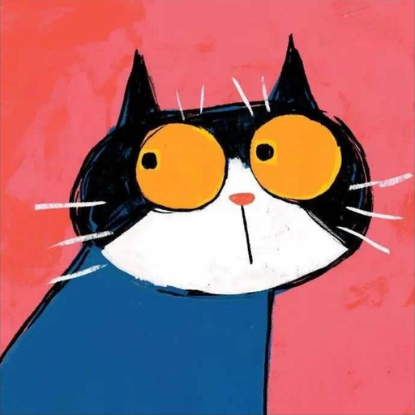
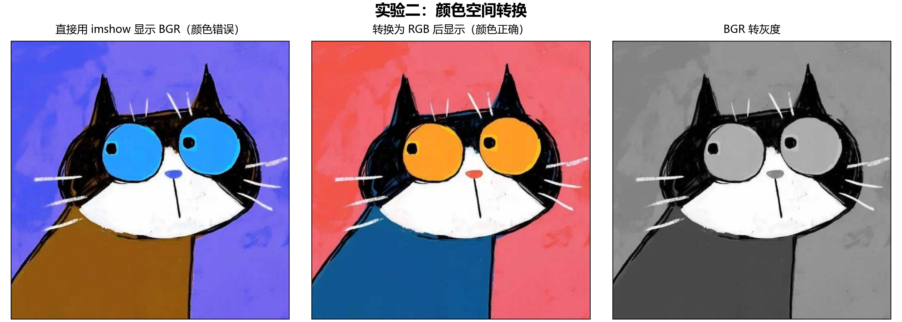
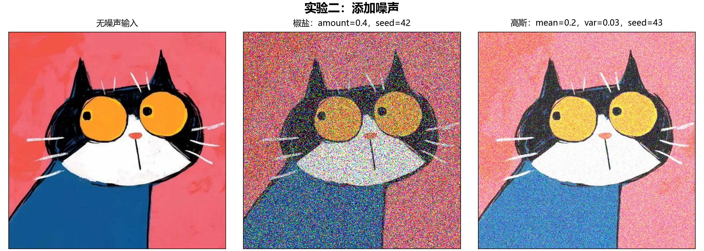
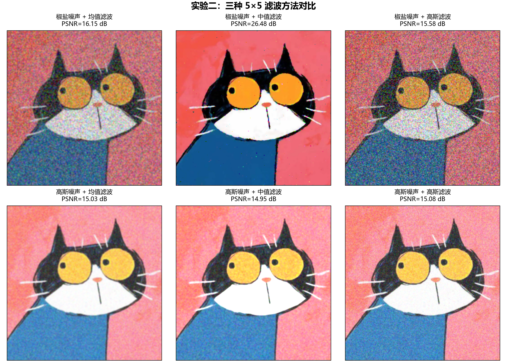
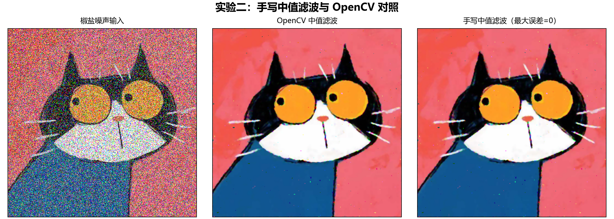
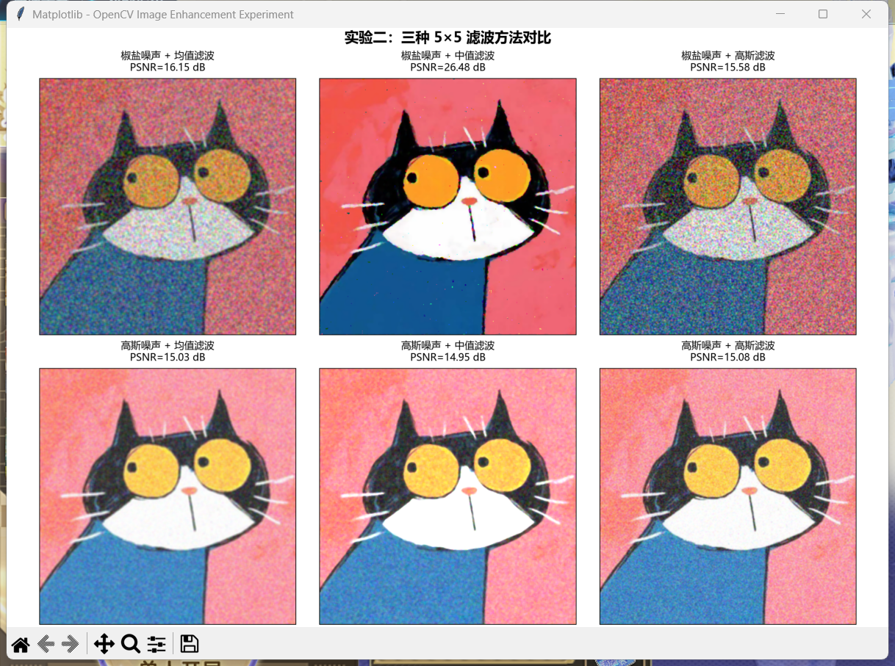
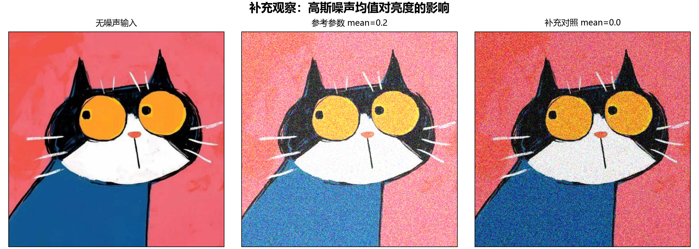

# 实验二：图像增强实验报告

## 一、实验目的

1. 掌握 OpenCV 彩色图像的读取、像素访问及 BGR、RGB、灰度之间的转换。
2. 了解椒盐噪声与高斯噪声的形成方式及视觉特点。
3. 使用均值滤波、中值滤波、高斯滤波处理含噪图像，分析去噪效果与细节损失。
4. 手动实现彩色图像中值滤波，并与 OpenCV 的结果进行逐像素验证。

## 二、实验环境与输入材料

### 2.1 软件环境

本实验在 Windows 环境中实际执行，主要软件版本如下。

| 软件或依赖库 | 实测版本 |
| --- | --- |
| Python | 3.12.14 |
| OpenCV | 4.11.0 |
| NumPy | 2.5.4 |
| scikit-image | 0.25.2 |
| Matplotlib | 3.10.1 |

OpenCV 使用 `opencv-python-headless`，承担实际图像计算；Matplotlib 负责输出图片，另用其 Tk 图窗显示结果并截取真实软件窗口。报告中的处理效果图均来自本次程序运行，没有使用 AI 绘制图片或拼制软件界面。

### 2.2 输入图像及来源

参考材料为用户提供的《实验二参考文档.pdf》，共 13 页。参考代码中的 `p1.jpg` 未单独提供，因此从 PDF 第 2 页的内嵌彩色结果图中提取猫咪图像区域，去掉坐标轴与白边后，使用 Lanczos 重采样为 **512×512** 像素，保存为 `input.png`，作为本次所有实验的共同输入。

这张输入图像是由参考材料恢复的实验素材，并非原始 `p1.jpg` 的逐像素副本；图像经过 PDF 压缩、裁切和重采样，像素值与原参考结果不同属于正常现象。以下像素值、去噪结果和评价指标均由本次输入重新计算。



### 2.3 参数设置

| 项目 | 设置 |
| --- | --- |
| 输入图像 | RGB 三通道，512×512，uint8 |
| 像素访问 | `image[100, 100]`，即从 0 开始计数的第 100 行、第 100 列 |
| 椒盐噪声 | `mode='s&p'`，`amount=0.4`，`rng=42` |
| 高斯噪声 | `mode='gaussian'`，`mean=0.2`，`var=0.03`，`rng=43` |
| 均值滤波 | 5×5 邻域 |
| 中值滤波 | 5×5 邻域 |
| 高斯滤波 | 5×5 邻域，`sigmaX=0`，由 OpenCV 根据核尺寸确定 |
| 手写中值滤波边界 | 复制边界，`np.pad(..., mode='edge')` |
| 结果图片 | 无损 PNG |

噪声函数先将图像转换到浮点范围，再添加噪声。所有含噪图像统一通过 `np.rint(np.clip(image, 0, 1) * 255).astype(np.uint8)` 转回 8 位整数，随后交给三种滤波方法，保证比较时的数据类型和量化方式一致。

## 三、实验原理

### 3.1 颜色空间转换

OpenCV 默认按 **BGR** 顺序读取彩色图像，Matplotlib 的 `imshow` 则按 **RGB** 顺序解释三通道数据。直接把 BGR 数组传给 `imshow` 会导致红蓝显示颠倒；使用 `cv2.cvtColor(bgr, cv2.COLOR_BGR2RGB)` 可以恢复正确的显示颜色。这是通道顺序的转换，不应把正确转换本身解释为对原物体进行颜色反转。

灰度转换使用 `cv2.COLOR_BGR2GRAY`，其亮度近似为：

```text
Y = 0.299R + 0.587G + 0.114B
```

彩色图像的形状为 `(H, W, 3)`，灰度图像的形状为 `(H, W)`。

### 3.2 两种噪声

椒盐噪声把随机选中的样本替换为极暗值或极亮值。本实验直接对三通道数组调用 `random_noise`，不同通道可能独立受影响，因此可出现彩色脉冲点；`amount=0.4` 不能简单等同于恰好 40% 的 RGB 像素整点同时变黑或变白。噪声采样与原值重合时，也不会形成可见变化。

高斯噪声模型为 `g = clip(f + n, 0, 1)`，其中 `n` 来自均值 0.2、方差 0.03 的高斯分布。这里的方差对应标准差约 0.1732。由于均值大于 0，图像不仅产生随机颗粒，也会整体变亮；裁剪到合法范围后，实际误差分布还会改变。

### 3.3 三种滤波

| 方法 | 邻域处理方式 | 主要特点 |
| --- | --- | --- |
| 均值滤波 | 取 5×5 窗口内的平均值 | 平滑随机波动，但极端噪点会参与平均，也会模糊边界 |
| 中值滤波 | 将窗口内数值排序后取中间值 | 对脉冲噪声有较强抑制能力，但可能削弱细线和纹理 |
| 高斯滤波 | 按高斯核加权平均，中心权重较高 | 平滑效果取决于核尺寸和标准差，对极端脉冲不具备中值的稳健性 |

本实验手写的是逐通道标量中值滤波：R、G、B 三通道分别计算，不是向量中值滤波。OpenCV 的中值滤波使用复制边界，因此手写实现使用相同的填充方式，以便比较整幅图像。

## 四、实验步骤与运行结果

### 4.1 导入依赖并读取图像

```python
import cv2
import numpy as np
from skimage.util import random_noise
from matplotlib import pyplot as plt

bgr = cv2.imdecode(np.fromfile('input.png', dtype=np.uint8), cv2.IMREAD_COLOR)
rgb = cv2.cvtColor(bgr, cv2.COLOR_BGR2RGB)
gray = cv2.cvtColor(bgr, cv2.COLOR_BGR2GRAY)
print(bgr[100, 100])
print(rgb[100, 100])
print(gray[100, 100])
```

本次实际输出：

```text
Input shape: (512, 512, 3)
BGR[100,100]: [114, 102, 244]
RGB[100,100]: [244, 102, 114]
Gray[100,100]: 146
```

该位置的红色分量最大，与输入图像相应位置的红色背景一致。不能把 BGR 数组输出直接称为 RGB 数值，也不能沿用参考文档中另一张分辨率图像的像素结果。

### 4.2 比较颜色转换结果



图 1：左图直接显示 BGR 数组，红色背景显示成蓝紫色；中图经过 BGR→RGB 转换，恢复红色背景、黄色眼睛和蓝色衣服；右图只保留亮度信息。

### 4.3 添加椒盐噪声与高斯噪声

```python
sp = random_noise(rgb, mode='s&p', amount=0.4, rng=42)
gaussian = random_noise(rgb, mode='gaussian', mean=0.2, var=0.03, rng=43)
sp_u8 = np.rint(np.clip(sp, 0, 1) * 255).astype(np.uint8)
gaussian_u8 = np.rint(np.clip(gaussian, 0, 1) * 255).astype(np.uint8)
```



图 2：椒盐噪声产生密集且突变的散点，破坏局部像素关系；高斯噪声造成较均匀的随机波动。由于本实验保持参考文档的 `mean=0.2`，高斯含噪图还呈现明显的亮度抬升。

### 4.4 使用三种方法滤波

```python
mean_sp = cv2.blur(sp_u8, (5, 5))
median_sp = cv2.medianBlur(sp_u8, 5)
gauss_sp = cv2.GaussianBlur(sp_u8, (5, 5), 0)

mean_gaussian = cv2.blur(gaussian_u8, (5, 5))
median_gaussian = cv2.medianBlur(gaussian_u8, 5)
gauss_gaussian = cv2.GaussianBlur(gaussian_u8, (5, 5), 0)
```



图 3：上排为椒盐噪声，下排为高斯噪声；每行从左到右分别为均值、中值、高斯滤波。中值滤波显著去除了椒盐噪声，但胡须等细线仍有损失，少量脉冲点也有残留。高斯噪声处理后随机波动减弱，但图像整体偏亮的问题仍然存在。

### 4.5 手动实现彩色中值滤波

算法对图像边界复制填充，然后遍历每个通道的每个像素，在对应的 5×5 窗口中计算中值，写入输出图像；完整实现见附录及 `experiment.py`。

为检查正确性，将手写结果与 `cv2.medianBlur` 的结果转换为有符号整数后相减，避免 `uint8` 减法回绕。

```python
manual = manual_median_filter_color(sp_u8, 5)
diff = np.abs(manual.astype(np.int16) - median_sp.astype(np.int16))
print(diff.max())
print(np.count_nonzero(diff))
```

实际验证结果：

| 检查项 | 结果 |
| --- | ---: |
| 最大绝对误差 | 0 |
| 存在差异的通道数值个数 | 0 |
| 手写算法本次运行耗时 | 6.2367 秒 |
| 整幅图像（包含边界）一致性 | 通过 |

耗时只反映本次机器及运行环境，不代表不同设备上的固定性能。



图 4：中图与右图逐像素一致，说明本次手写实现的窗口取值、逐通道运算及边界处理均与 OpenCV 的 5×5 中值滤波相符。

### 4.6 真实软件窗口截图

下图为本次在 Windows 上实际打开的 **Matplotlib Tk 图窗截图**，图窗显示的是前述 OpenCV 计算得到的滤波结果。上面的图 1～图 4 使用程序导出的高清图片，以便阅读细节。



## 五、定量评价与分析

### 5.1 评价方法

以本次无噪声输入 `input.png` 为基准，计算整幅 RGB 图像的 MSE、PSNR 和 SSIM。

```text
MSE = mean((处理图 - 无噪声输入图)²)
PSNR = 10 × log10(255² / MSE)
平均通道偏差 = mean(处理图 - 无噪声输入图)
```

MSE 越小越好，PSNR 越大越好；SSIM 使用 `channel_axis=-1, data_range=255`，数值越接近 1，通常表示局部结构越相似。平均通道偏差是三个颜色通道的平均有符号误差，用于观察整体偏亮或偏暗，不等同于感知亮度差。所有指标使用未带坐标轴、标题和软件窗口边框的原始数组计算。

### 5.2 主实验测量结果

| 噪声类型 | 处理方法 | MSE ↓ | PSNR / dB ↑ | SSIM ↑ | 平均通道偏差 |
| --- | --- | ---: | ---: | ---: | ---: |
| 椒盐噪声 | 未滤波 | 9283.96 | 8.45 | 0.0408 | -0.91 |
| 椒盐噪声 | 均值滤波 | 1578.34 | 16.15 | 0.2579 | -0.90 |
| 椒盐噪声 | 中值滤波 | 146.20 | 26.48 | 0.9209 | -0.16 |
| 椒盐噪声 | 高斯滤波 | 1800.72 | 15.58 | 0.1795 | -0.90 |
| 高斯噪声 | 未滤波 | 3190.88 | 13.09 | 0.1891 | +37.94 |
| 高斯噪声 | 均值滤波 | 2040.55 | 15.03 | 0.5797 | +37.95 |
| 高斯噪声 | 中值滤波 | 2078.83 | 14.95 | 0.5432 | +39.64 |
| 高斯噪声 | 高斯滤波 | 2020.24 | 15.08 | 0.5005 | +37.96 |

**椒盐噪声：** 中值滤波的 PSNR 从未滤波时的 8.45 dB 提升到 26.48 dB，SSIM 提升到 0.9209，明显优于相同窗口下的均值滤波和高斯滤波。原因是中值运算不直接平均极端值，能够保留邻域中的主体信息。均值和高斯滤波虽然减轻了散点的强烈跳变，但残留的彩色颗粒较多。

**高斯噪声：** 本次 5×5 高斯滤波的 PSNR 为 15.08 dB，略高于均值滤波的 15.03 dB；均值滤波的 SSIM 为 0.5797，高于高斯滤波的 0.5005。因此，不同指标给出的排序并不完全相同，不能简单认定一种方法在所有意义上都最佳。

**亮度偏移：** 高斯含噪图的平均通道偏差为 +37.94，均值滤波后仍为 +37.95，高斯滤波后仍为 +37.96。局部平滑主要抑制随机变化，无法直接消除非零均值引入的系统偏移；部分亮区经过裁剪，信息也已损失。这解释了滤波后的图像仍然偏亮。

### 5.3 补充对照：将高斯噪声均值改为 0

为区分随机噪声和整体偏移的作用，保持 `var=0.03`、随机种子 43 以及滤波窗口不变，仅将高斯噪声均值改为 0。此项为补充实验，前面的主实验仍采用参考文档参数。



| 噪声类型 | 处理方法 | MSE ↓ | PSNR / dB ↑ | SSIM ↑ | 平均通道偏差 |
| --- | --- | ---: | ---: | ---: | ---: |
| 高斯噪声（零均值补充） | 未滤波 | 1489.16 | 16.40 | 0.1395 | -1.35 |
| 高斯噪声（零均值补充） | 均值滤波 | 262.51 | 23.94 | 0.6004 | -1.33 |
| 高斯噪声（零均值补充） | 中值滤波 | 183.32 | 25.50 | 0.5158 | -0.28 |
| 高斯噪声（零均值补充） | 高斯滤波 | 245.89 | 24.22 | 0.4894 | -1.33 |

零均值条件下，均值滤波与高斯滤波的 PSNR 分别为 23.94 dB 和 24.22 dB，较主实验明显提高；本张图像上中值滤波的 PSNR 达到 25.50 dB，而均值滤波的 SSIM 最高。输入图像中存在大面积平坦色块、强边缘以及接近极值的区域，加噪后的范围裁剪也会影响排序。这些测量结果说明，噪声分布、图像内容、边界、核参数和评价指标都会影响方法选择，不能把参考示例中的结论当作所有图像的固定排序。

## 六、实验中需要注意的问题

1. **读取失败。** 读取图像后检查返回值，避免在空图像上取像素或调用颜色转换。完整脚本采用 `np.fromfile` 配合 `cv2.imdecode`，以兼容 Windows 中文路径。
2. **颜色通道。** `bgr[100, 100]` 得到的是 B、G、R 顺序；展示、解释和保存时应分别确认所需的通道顺序。
3. **数据范围。** `random_noise` 的输出是浮点图像，不能不经缩放就直接转换成 `uint8`，否则大部分数值会变成 0 或 1。
4. **公平比较。** 三种滤波均使用同一份量化后的含噪数组，避免数据类型差异影响比较。
5. **边界一致性。** 手写中值滤波采用复制边界；若改成零填充，图像边缘可能与 OpenCV 产生差异。
6. **输出路径。** 提前创建结果目录，避免 `savefig` 因目录不存在而失败；本次统一保存为 PNG，避免有损压缩干扰后续指标。
7. **结论范围。** `amount=0.4` 是较强的脉冲污染，`mean=0.2` 会造成明显偏亮；分析时必须保留这些条件。

## 七、实验小结

本实验完成了图像读取、像素访问、BGR→RGB 转换、灰度转换、椒盐与高斯噪声添加，以及三种滤波方法的实际运行。椒盐噪声条件下，5×5 中值滤波在本次测量中表现最优；手写逐通道中值滤波与 OpenCV 的输出完全一致，验证了算法实现的正确性。

对于高斯噪声，均值滤波与高斯滤波均可降低随机波动，但其恢复效果受到噪声均值及裁剪的影响。主实验中高斯滤波的 PSNR 略优，均值滤波的 SSIM 更高；补充零均值对照进一步表明，不能仅根据噪声名称选择滤波方法，应结合实际图像、参数与评价目标进行判断。

## 八、文件说明与复现方法

```text
实验二_图像增强实验报告.md     本报告（包含完整代码）
input.png                      从参考PDF恢复的实验输入
experiment.py                  完整可运行程序
requirements.txt               主依赖版本
run_log.txt                    本次实际执行日志
images/                        高清结果图与真实图窗截图
data/metrics.csv               全部测量指标
data/results.json              软件版本、像素值、验证结果
data/*.png                     不含标题与边框的处理结果
```

将完整文件夹解压后，使用支持 Markdown 图片预览的编辑器打开报告。复制或提交时应保留 `images` 目录及 `input.png` 与 Markdown 的相对位置。

在配置好 Python 的环境中，于解压目录执行：

```bash
python -m pip install -r requirements.txt
python experiment.py
```

脚本将重新生成处理图片和测量数据，手写中值滤波需要几秒至更长时间，具体取决于机器性能。软件窗口截图是本次实际截取的留档；脚本默认采用非交互式后端生成高清结果图。

## 附录：完整实验代码

```python
"""实验二：图像增强"""
from pathlib import Path
import csv
import json
import platform
import time

import cv2
import numpy as np
import skimage
from skimage.util import random_noise
from skimage.metrics import structural_similarity
import matplotlib
matplotlib.use('Agg')
from matplotlib import pyplot as plt
from matplotlib import font_manager

BASE = Path(__file__).resolve().parent
FIG = BASE / 'images'
DATA = BASE / 'data'
for folder in (FIG, DATA):
    folder.mkdir(exist_ok=True)
for candidate in ('Microsoft YaHei', 'SimHei', 'Noto Sans CJK SC'):
    if candidate in {f.name for f in font_manager.fontManager.ttflist}:
        plt.rcParams['font.sans-serif'] = [candidate]
        break
plt.rcParams.update({'font.size': 11, 'axes.unicode_minus': False})


def to_u8(image):
    """统一到 0..255 的 uint8，供所有滤波方法公平比较。"""
    return np.rint(np.clip(image, 0, 1) * 255).astype(np.uint8)


def manual_median_filter_color(image, kernel_size=5):
    """逐像素、逐通道计算中值，边界使用复制填充。"""
    if image.ndim != 3 or image.shape[2] != 3:
        raise ValueError('image 必须是 H×W×3 彩色图像')
    if image.dtype != np.uint8:
        raise ValueError('image 必须是 uint8')
    if not isinstance(kernel_size, int) or kernel_size < 3 or kernel_size % 2 == 0:
        raise ValueError('kernel_size 必须是大于等于 3 的奇数')
    pad = kernel_size // 2
    padded = np.pad(image, ((pad, pad), (pad, pad), (0, 0)), mode='edge')
    result = np.empty_like(image)
    for c in range(3):
        for y in range(image.shape[0]):
            for x in range(image.shape[1]):
                window = padded[y:y + kernel_size, x:x + kernel_size, c]
                result[y, x, c] = np.median(window)
    return result


def grid(items, shape, filename, title, figsize):
    fig, axes = plt.subplots(*shape, figsize=figsize, constrained_layout=True)
    fig.suptitle(title, fontsize=17, fontweight='bold')
    for ax, (image, label) in zip(np.asarray(axes).ravel(), items):
        ax.imshow(image, cmap='gray' if image.ndim == 2 else None,
                  vmin=0 if image.ndim == 2 else None,
                  vmax=255 if image.ndim == 2 else None)
        ax.set_title(label, fontsize=12, pad=9)
        ax.set_xticks([])
        ax.set_yticks([])
    fig.savefig(FIG / filename, dpi=180, facecolor='white')
    plt.close(fig)


def evaluate(reference, image):
    delta = image.astype(np.float64) - reference.astype(np.float64)
    mse = float(np.mean(delta ** 2))
    return {
        'MSE': mse,
        'PSNR_dB': float(10 * np.log10(255 ** 2 / mse)) if mse else float('inf'),
        'SSIM': float(structural_similarity(reference, image, channel_axis=-1,
                                          data_range=255)),
        'bias': float(np.mean(delta)),
    }


def main():
    # imdecode 兼容 Windows 中文路径；读入后的通道顺序为 BGR。
    raw = np.fromfile(BASE / 'input.png', dtype=np.uint8)
    bgr = cv2.imdecode(raw, cv2.IMREAD_COLOR)
    if bgr is None or min(bgr.shape[:2]) <= 100:
        raise ValueError('input.png 无法读取或尺寸过小')
    rgb = cv2.cvtColor(bgr, cv2.COLOR_BGR2RGB)
    gray = cv2.cvtColor(bgr, cv2.COLOR_BGR2GRAY)
    pixel_bgr = bgr[100, 100].tolist()
    pixel_rgb = rgb[100, 100].tolist()
    print('Python:', platform.python_version())
    print('OpenCV:', cv2.__version__)
    print('NumPy:', np.__version__)
    print('scikit-image:', skimage.__version__)
    print('Matplotlib:', matplotlib.__version__)
    print('Input shape:', rgb.shape)
    print('BGR[100,100]:', pixel_bgr)
    print('RGB[100,100]:', pixel_rgb)
    print('Gray[100,100]:', int(gray[100, 100]))
    grid([(bgr, '直接用 imshow 显示 BGR（颜色错误）'),
          (rgb, '转换为 RGB 后显示（颜色正确）'),
          (gray, 'BGR 转灰度')], (1, 3), '01_color_spaces.png',
         '实验二：颜色空间转换', (14, 5))

    # 两次使用独立且固定的种子，保证能够复现每一种噪声。
    noisy = {
        '椒盐噪声': to_u8(random_noise(rgb, mode='s&p', amount=0.4, rng=42)),
        '高斯噪声': to_u8(random_noise(rgb, mode='gaussian', mean=0.2,
                                     var=0.03, rng=43)),
    }
    grid([(rgb, '无噪声输入'), (noisy['椒盐噪声'], '椒盐：amount=0.4，seed=42'),
          (noisy['高斯噪声'], '高斯：mean=0.2，var=0.03，seed=43')],
         (1, 3), '02_noise_comparison.png', '实验二：添加噪声', (14, 5))

    rows, filtered, items = [], {}, []
    for noise_name, image in noisy.items():
        filtered[noise_name] = {
            '均值滤波': cv2.blur(image, (5, 5)),
            '中值滤波': cv2.medianBlur(image, 5),
            '高斯滤波': cv2.GaussianBlur(image, (5, 5), 0),
        }
        for method, result in {'未滤波': image, **filtered[noise_name]}.items():
            row = {'noise': noise_name, 'method': method, **evaluate(rgb, result)}
            rows.append(row)
            print(f'{noise_name} | {method}: MSE={row["MSE"]:.4f}, '
                  f'PSNR={row["PSNR_dB"]:.4f} dB, SSIM={row["SSIM"]:.6f}, '
                  f'bias={row["bias"]:.4f}')
            if method != '未滤波':
                items.append((result, f'{noise_name} + {method}\n'
                                      f'PSNR={row["PSNR_dB"]:.2f} dB'))
    grid(items, (2, 3), '03_filter_results.png',
         '实验二：三种 5×5 滤波方法对比', (14, 10))

    start = time.perf_counter()
    manual = manual_median_filter_color(noisy['椒盐噪声'], 5)
    elapsed = time.perf_counter() - start
    opencv = filtered['椒盐噪声']['中值滤波']
    difference = np.abs(manual.astype(np.int16) - opencv.astype(np.int16))
    max_error = int(difference.max())
    differing_values = int(np.count_nonzero(difference))
    assert max_error == 0, '手写算法与 OpenCV 结果不一致'
    print('Manual median max absolute error:', max_error)
    print('Manual median differing channel values:', differing_values)
    print('Manual median time (seconds):', round(elapsed, 4))
    grid([(noisy['椒盐噪声'], '椒盐噪声输入'), (opencv, 'OpenCV 中值滤波'),
          (manual, f'手写中值滤波（最大误差={max_error}）')], (1, 3),
         '04_manual_median.png', '实验二：手写中值滤波与 OpenCV 对照', (14, 5))

    # 补充零均值对照，区分随机扰动和参考参数带来的亮度偏移。
    zero = to_u8(random_noise(rgb, mode='gaussian', mean=0.0, var=0.03, rng=43))
    zero_results = {
        '未滤波': zero,
        '均值滤波': cv2.blur(zero, (5, 5)),
        '中值滤波': cv2.medianBlur(zero, 5),
        '高斯滤波': cv2.GaussianBlur(zero, (5, 5), 0),
    }
    zero_rows = [{'noise': '高斯噪声（零均值补充）', 'method': method,
                  **evaluate(rgb, result)} for method, result in zero_results.items()]
    grid([(rgb, '无噪声输入'), (noisy['高斯噪声'], '参考参数 mean=0.2'),
          (zero, '补充对照 mean=0.0')], (1, 3), '05_gaussian_bias.png',
         '补充观察：高斯噪声均值对亮度的影响', (14, 5))

    with (DATA / 'metrics.csv').open('w', encoding='utf-8-sig', newline='') as f:
        writer = csv.DictWriter(f, fieldnames=list(rows[0]))
        writer.writeheader()
        writer.writerows(rows + zero_rows)
    results = {
        'versions': {'Python': platform.python_version(), 'OpenCV': cv2.__version__,
                     'NumPy': np.__version__, 'scikit-image': skimage.__version__,
                     'Matplotlib': matplotlib.__version__},
        'shape': list(rgb.shape), 'pixel_bgr': pixel_bgr, 'pixel_rgb': pixel_rgb,
        'pixel_gray': int(gray[100, 100]), 'rows': rows, 'zero_mean_rows': zero_rows,
        'manual': {'max_absolute_error': max_error,
                   'differing_channel_values': differing_values, 'seconds': elapsed},
    }
    (DATA / 'results.json').write_text(json.dumps(results, ensure_ascii=False, indent=2),
                                     encoding='utf-8')
    for name, image in [('rgb', rgb), ('gray', gray), ('salt_pepper', noisy['椒盐噪声']),
                        ('gaussian', noisy['高斯噪声']), ('manual_median', manual)]:
        save = cv2.cvtColor(image, cv2.COLOR_RGB2BGR) if image.ndim == 3 else image
        cv2.imencode('.png', save)[1].tofile(DATA / f'{name}.png')
    print('Experiment completed. Manual/OpenCV equality: PASS')


if __name__ == '__main__':
    main()
```

