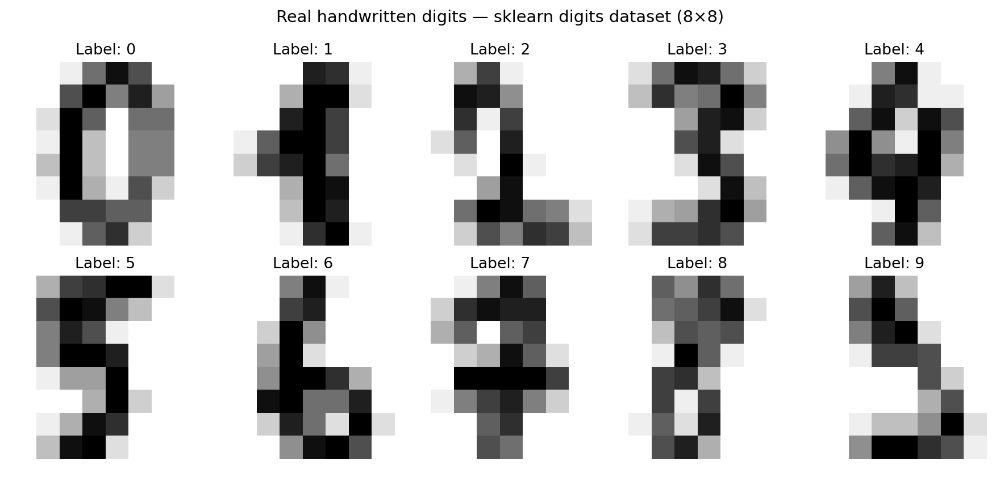
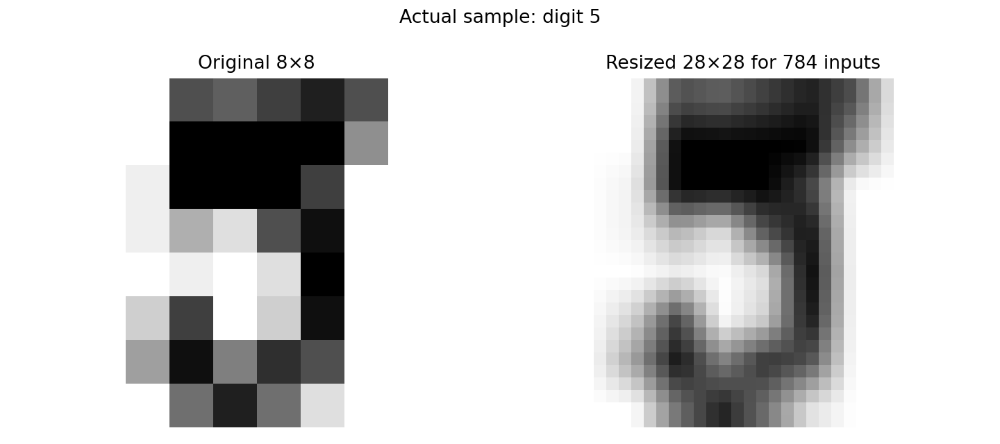
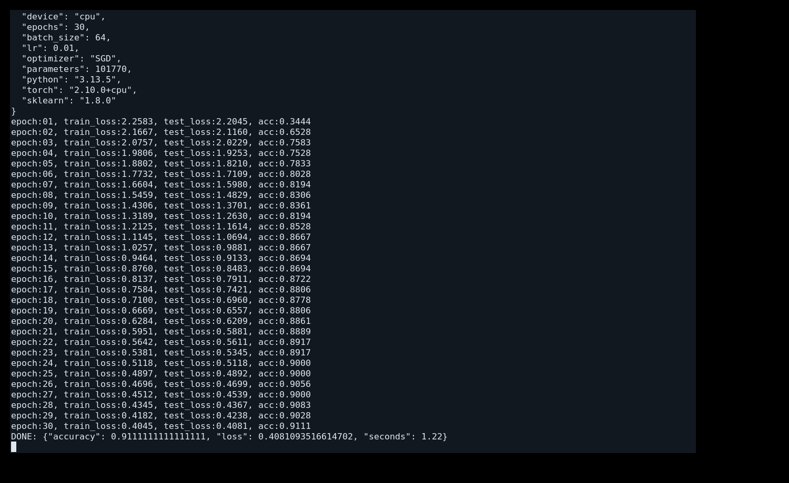
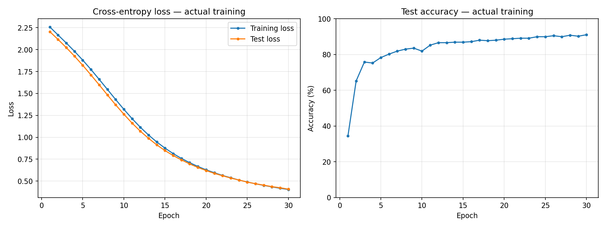
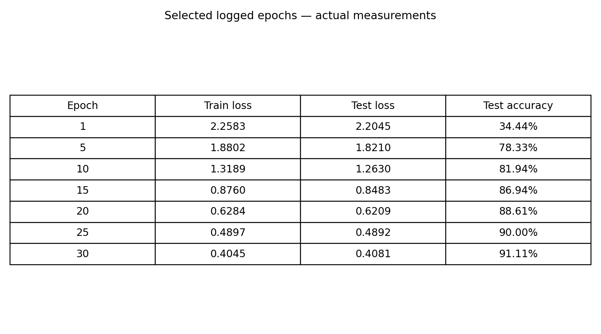
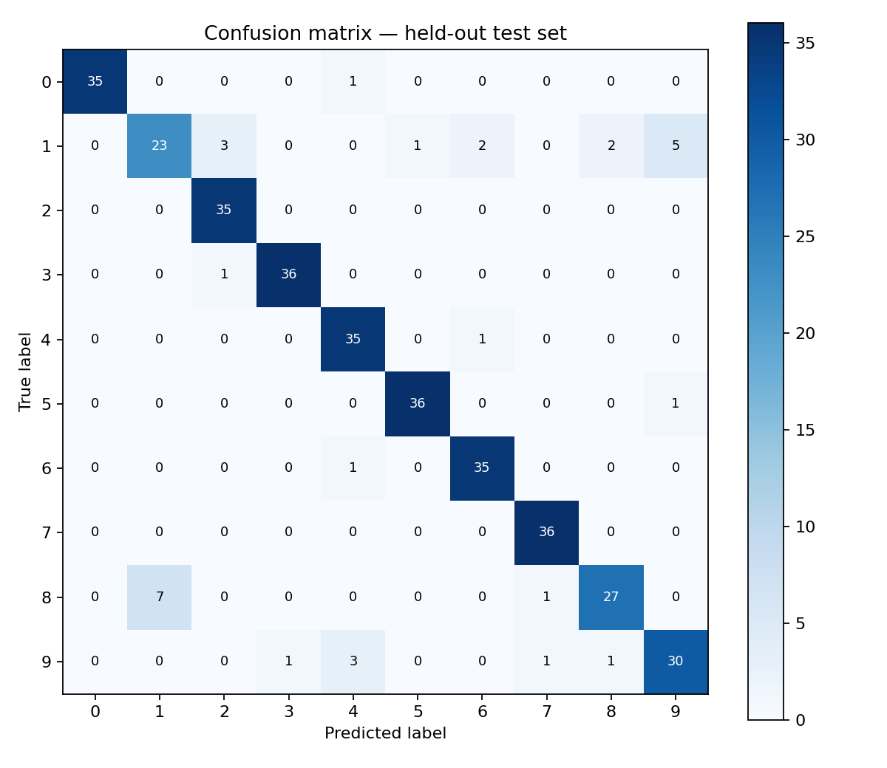
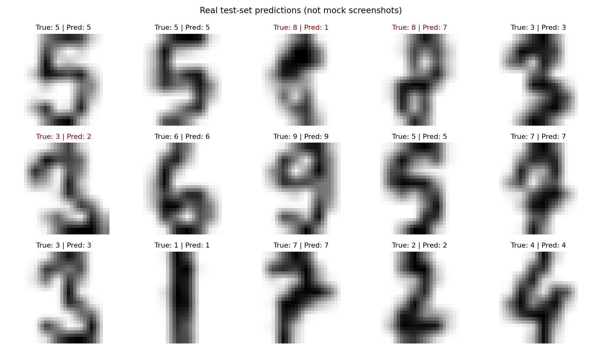

# 实验四：基于 PyTorch 的 MLP 手写数字分类实验报告

## 一、实验名称

基于 PyTorch 多层感知机（MLP）的手写数字识别实验。

## 二、实验目的

1. 熟悉 PyTorch 神经网络的搭建、前向传播和反向传播过程。
2. 掌握全连接层、ReLU 激活函数和交叉熵损失函数的作用。
3. 使用随机梯度下降（SGD）优化模型参数，并测试识别准确率。
4. 利用真实测试数据、训练曲线和混淆矩阵分析分类性能。

## 三、实验环境和数据集

| 项目 | 本次实际运行配置 |
|---|---|
| Python | 3.13.5 |
| PyTorch | 2.10.0+cpu |
| scikit-learn | 1.8.0 |
| 运行设备 | CPU |
| 数据集 | sklearn `load_digits`，**非 MNIST** |
| 原图大小 | 8×8 灰度图，重采样为 28×28 输入 |
| 总样本数 | 1797 |
| 训练集 / 测试集 | 1437 / 360 |
| 随机种子 | 42，分层划分 |
| 训练轮数 | 30 |
| 批大小 | 64（参考代码为 2048，因数据集规模较小而调整） |
| 学习率 | 0.01 |
| 优化器 | SGD |
| 可训练参数量 | 101,770 |

**差异说明：** 参考代码调用 `torchvision.datasets.MNIST(download=True)`，处理的是 28×28 的 MNIST 图像；本次离线代码采用本地 `load_digits` 实际手写样本（8×8）并通过 `torch.nn.functional.interpolate` 重采样到 28×28，使网络输入仍为 784 维。为适应仅 1437 条训练数据，批大小设为 64。网络结构、交叉熵、SGD 学习率和 30 轮训练均沿用参考思路。仅重采样不会凭空增加图像细节。

## 四、实验原理

### 4.1 多层感知机

参考代码的模型由两个全连接层构成：`nn.Linear(784, 128)`、`nn.Linear(128, 10)`，中间使用 ReLU。输入为展平后的 28×28 图像，输出为数字 0～9 的 10 维分类分数。

```text
输入图像 (28×28)
    ↓ 展平 (784)
Linear(784,128)
    ↓ ReLU
Linear(128,10)
    ↓ 类别预测 argmax
数字 0～9
```

### 4.2 损失函数与优化方法

使用多分类交叉熵损失 `F.cross_entropy(output, y)`，通过 `loss.backward()` 计算梯度，再执行 `optimizer.step()` 更新参数；测试阶段使用 `model.eval()` 和 `torch.no_grad()` 关闭梯度计算。

### 4.3 准确率

测试准确率 = 测试集中预测正确的样本数 ÷ 测试样本总数。本次测试集固定为 360 条。

## 五、实验步骤与真实实验截图

### 步骤 1：加载和查看真实手写数字数据

通过 `load_digits()` 获取真实手写数字样本，标签覆盖 0 至 9。以下图片由运行脚本直接读取数据集并使用 Matplotlib 绘图导出，**不是示意图**。



*图1：实际加载的 8×8 手写数字样本及其标签。*

### 步骤 2：数据预处理与划分

将像素值缩放至 0～1；将 8×8 重采样到 28×28；按 8:2 分层划分训练集和测试集，并将图像展平成 784 维向量。



*图2：真实样本在 8×8 和 28×28 下的处理结果。*

### 步骤 3：搭建模型并开始训练

核心网络结构与参考代码一致：

```python
class MLP(nn.Module):
    def __init__(self):
        super().__init__()
        self.l1 = nn.Linear(784, 128)
        self.l2 = nn.Linear(128, 10)

    def forward(self, x):
        return self.l2(F.relu(self.l1(x)))

model = MLP().to(device)
optimizer = optim.SGD(model.parameters(), lr=0.01)
```

训练步骤：获取一批图像与标签 → `optimizer.zero_grad()` → 前向传播 → 交叉熵 → `loss.backward()` → `optimizer.step()`；每轮结束后在独立测试集上计算损失及准确率。



*图3：真实 X11 终端窗口显示运行日志的屏幕截图（通过 Xvfb + xterm + scrot 截取），其中训练数据来自本次程序实际输出，非人工排版或虚构运行结果。*

### 步骤 4：观察训练与测试指标变化



*图4：依据本次真实记录的 30 轮损失和准确率绘制的 Matplotlib 输出。*

下表为本次真实日志中选出的部分轮次：

| Epoch | Train loss | Test loss | Test accuracy |
|---:|---:|---:|---:|
| 1 | 2.2583 | 2.2045 | 34.44% |
| 5 | 1.8802 | 1.8210 | 78.33% |
| 10 | 1.3189 | 1.2630 | 81.94% |
| 15 | 0.8760 | 0.8483 | 86.94% |
| 20 | 0.6284 | 0.6209 | 88.61% |
| 25 | 0.4897 | 0.4892 | 90.00% |
| 30 | 0.4045 | 0.4081 | 91.11% |



*图5：由同一份训练记录直接生成的数据表。*

### 步骤 5：测试集分类与误差分析



*图6：360 个真实测试样本的混淆矩阵，横轴是预测值，纵轴是真实标签。*



*图7：从保留测试集中实际抽取的样本，标题显示真实标签及模型预测标签。*

## 六、实验结果与分析

1. **最终测试准确率：91.11%**。在 360 条测试记录中，分类正确 328 条。
2. **最终平均测试交叉熵损失：0.4081**。
3. 第 1 轮测试准确率为 34.44%，第 30 轮提高到 91.11%；测试损失由 2.2045 降至 0.4081，表明模型在该数据集上学到了有效的分类特征。
4. 由混淆矩阵可以看到，有些数字类别之间仍然存在混淆，可能与笔迹形状相似、8×8 原始分辨率较低以及模型结构较简单有关。
5. **限制：** 此结果不是 MNIST 基准成绩，不能将 91.11% 表述为 MNIST 测试准确率。测试集按固定种子划分，但在不同硬件或不同库版本上可能产生细微差异。

## 七、实验中遇到的问题与处理方法

**问题 1：无法下载 MNIST。** 当前执行环境无可用网络，参考代码中的 `download=True` 无法获得数据。处理方法是以本地安装包自带的真实手写数字数据集开展离线验证，并在代码与报告中清晰标明数据替换。

**问题 2：输入尺寸不同。** 参考网络需 784 维输入，而 `load_digits` 原图仅 8×8。使用双线性插值重采样至 28×28 后展平，保持与参考代码一致的网络输入层维度。

**问题 3：批大小不适配。** 参考数据集有 60000 张训练图片，batch_size=2048；当前数据集训练集仅 1437 张，故批大小调整为 64，以在每轮中执行更多次参数更新。

## 八、实验总结

通过本次实验，完成了手写数字数据加载、数据预处理、MLP 模型定义、SGD 训练、交叉熵计算和测试集评估的完整流程，并获得真实的终端输出、损失与准确率曲线、混淆矩阵和预测可视化结果。实验验证了两层全连接网络能够学习手写数字的分类规律，同时认识到数据集差异、样本规模和模型结构会影响实验结论。


